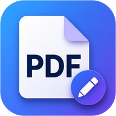
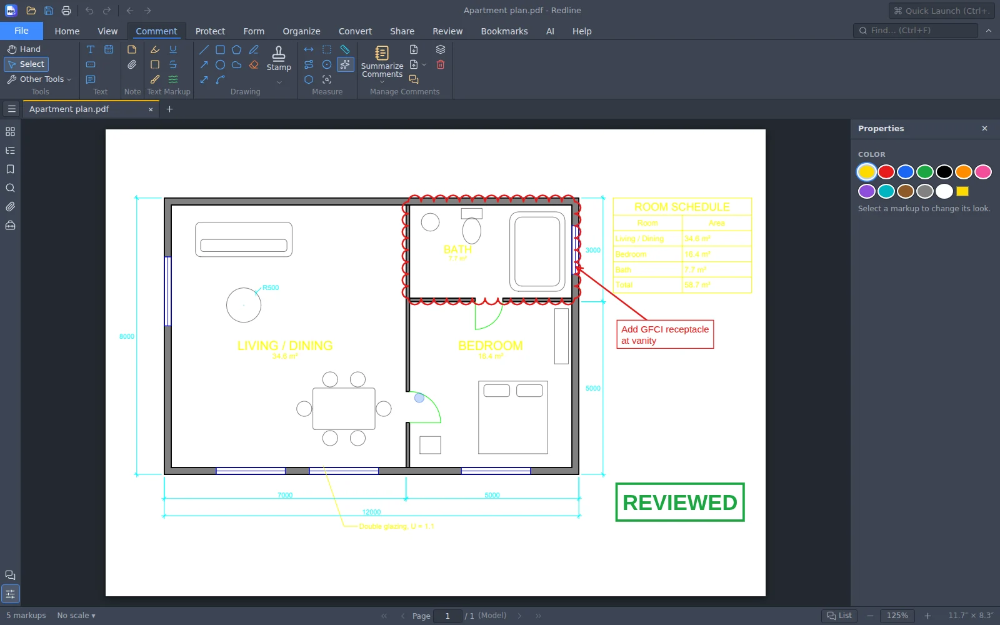

<h1 align="center">Redline</h1>

  <b>A free PDF editor for construction drawings: markup, measure, count and sign.</b> 
  Cloud it, count it, measure it, stamp it, sign it. Fast on big plan sets.
  It runs on your own computer, so your drawings never leave it. No ads, no subscription, no account.

  <a href="https://github.com/AICodeForgedev/redline/releases/latest/download/Redline-Windows.exe"><b>⬇ Download for Windows</b></a>
  &nbsp;·&nbsp;
  <a href="https://github.com/AICodeForgedev/redline/releases/latest/download/Redline-Mac.dmg"><b>⬇ Download for Mac</b></a>
  (<a href="https://github.com/AICodeForgedev/redline/releases/latest/download/Redline-Mac-Intel.dmg">Intel Mac</a>)
  &nbsp;·&nbsp;
  <a href="https://github.com/AICodeForgedev/redline/releases">All versions</a>

<a href="https://aicodeforge.dev">aicodeforge.dev</a> · also from AICodeForge: <a href="https://github.com/AICodeForgedev/cadaddy"><b>CADaddy</b></a>, free 2D CAD that opens and saves DWG and DXF

## Install

**Windows 10 or 11 (64-bit)**
1. Download **Redline-Windows.exe** and open it.
2. If Windows says *"Windows protected your PC"*, click **More info → Run anyway**. The installer isn't code-signed yet.
3. It installs in a few seconds; click **Close**. No administrator password needed.

Redline opens from its desktop or Start menu shortcut, in its own window (it uses Microsoft Edge, which comes with Windows).

**Mac (macOS 12 or newer)**
1. Download **Redline-Mac.dmg** for a Mac with an Apple chip (M1 or later), or **Redline-Mac-Intel.dmg** for an Intel Mac. Not sure? Apple menu ▸ About This Mac shows "Chip" (Apple) or "Processor" (Intel).
2. Open it and drag **Redline** onto **Applications**.
3. The first time, if your Mac says it *"could not verify"* Redline, open **System Settings ▸ Privacy & Security** and click **Open Anyway**. The app isn't notarized yet.

## What it does

- Clouds, arrows, callouts, text, stamps and highlights.
- Measures lengths and areas at the drawing's own scale.
- Counts symbols across a sheet.
- Fills forms, merges, splits, redacts and signs.
- Finds the text in scanned sheets (OCR), on your computer.
- Scrolls, flips and zooms big, dense plan sheets quickly. Pages are drawn with PDFium, Chrome's PDF engine.

## Feedback and support

- **Found a bug or want a feature?** In Redline, click **Donate / Improve** at the top right, then **Report a Bug** or **Request a Feature**. You can also email **feedback@aicodeforge.dev**.
- **Like it?** Redline is free, and it stays that way. A donation pays for the AI time that builds the next features: **[Donate to Redline](https://aicodeforge.dev/redline/donate)**.

## License

Redline is free to download and use. This repository holds its releases; the source code isn't published.
Redline is built on open-source software, including PDFium, PDF.js, pdf-lib and Tesseract.js. Their licenses are in
[THIRD-PARTY-NOTICES.md](THIRD-PARTY-NOTICES.md).
